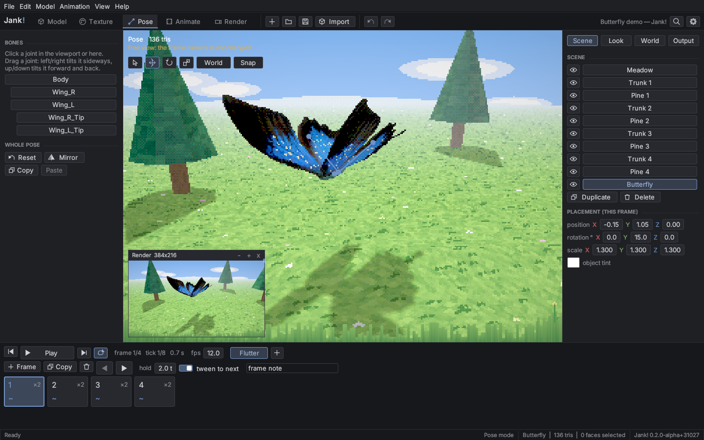
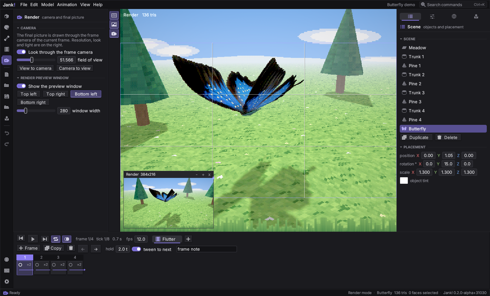
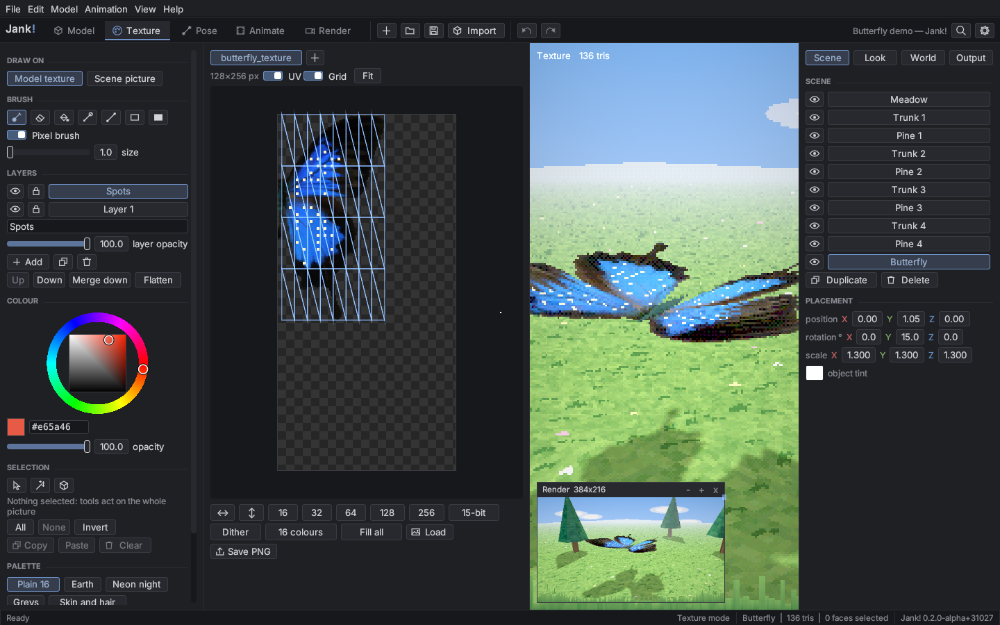

<div align="center">

# Jank!

**A cosy studio for low-poly, PlayStation-1-style 3D.**
Model it. Paint it. Pose it. Animate it. Render it. All in one small program.

`0.2.0-alpha` · Linux · Written in Rust · No external tools needed
</div>



| Render mode with soft shadows | Texture painting |
|---|---|
|  |  |

---

## What is Jank!?

Remember how games looked on the original PlayStation? Chunky triangles, wobbly textures, big pixels, foggy distances. Jank! lets you make that look on purpose.

It is a single program where you can:

| Step | What you do | Where |
|---|---|---|
| **Model** | Build shapes from cubes, spheres, cylinders and more, or import a model you already have. Edit vertices, edges and polygons (`Tab`), cut and join shapes, cut the triangle count down while keeping the silhouette. | `Model` mode (key `1`) |
| **Texture** | Paint pixels straight onto the model. Palettes, layers, dithering, a live preview. | `Texture` mode (key `2`) |
| **Pose** | Bend the skeleton of an imported model into a pose, bone by bone or by dragging the end of a chain. | `Pose` mode (key `3`) |
| **Animate** | Make frame-by-frame animation, like a flip-book. | `Animate` mode (key `4`) |
| **Render** | Get the retro look (wobbly vertices, 15-bit colour, dithering, fog) and save a picture or a video. | `Render` mode (key `5`) |

You do not need to know any 3D software first. Everything has a tooltip: hold the mouse over anything and it tells you what it does.

## Who is it for?

- Indie game developers who want PS1-style assets without learning a huge 3D package.
- Pixel and low-poly artists who like the look and want a focused, calm tool.
- Anyone who wants to make a quick retro picture, GIF or short animation.

## Features

- **Modeling**: primitives (cube, plane, cylinder, cone, sphere, torus, butterfly), extrude, subdivide, mirror, weld, flat shading, automatic UV unwrap, polygon reduction, move / rotate / scale gizmos with snapping.
- **Edit mode** (`Tab`): vertices, edges and polygons as in Blender. Box select, loops and rings, grow and shrink, hide and reveal; `G` / `R` / `S` with axis locks, typed values and proportional editing; extrude, inset, bevel, loop cut, knife, bridge, merge, split, separate, symmetrize, seams and UV unwrap from seams. Quads and n-gons are kept.
- **Boolean operations**: union, difference and intersection of two objects, or inside one mesh.
- **Reference pictures**: front, side, top or facing the view, with size and opacity. Never rendered or exported.
- **Import**: OBJ, STL, PLY, glTF and GLB (with skeletons).
- **Texture painting**: brush, eraser, fill, picker, line, rectangle, selection, smudge, blur, dodge, burn and gradient tools; second colour, symmetry, stroke stabilizer; palettes, dithering, colour reduction, layers.
- **Indexed colour**: lock a texture to a palette like a PlayStation CLUT; change a palette entry and the whole texture follows.
- **Projection painting**: paint through the view onto every visible object, across UV seams.
- **Posing and animation**: bones, inverse kinematics (`Shift+I`), frame-by-frame animation, and a graph editor (the *Curves* tab) for keys and easing.
- **Scene layers**: pictures behind and in front of the 3D scene (a sky behind, grass in front).
- **Time of day**: a sun by day, a moon by night; light, sky and fog follow the hour.
- **Shadows**: Off, Blob (the soft spot under things, very PS1) or Cast (real soft shadows, with quality and softness controls).
- **PSX render look**: affine textures, vertex snapping, colour depth, dithering, fog, low resolution.
- **Output**: PNG, JPEG, BMP, TGA, PPM, GIF and AVI. Nothing else has to be installed.
- **Comfort**: radial menu on `Space` (as in Krita), command palette (`Ctrl+K`), remappable hotkeys, undo/redo, autosave and crash recovery, saved layout, UI scale, highlight under the mouse, colour themes (stored as files you can share), "What's new" after an update, seasonal splash screens.
- **Discord status** (optional, off by default for the project name): "Playing Jank!" with the mode and the time. It talks only to the Discord app on your computer. See [docs/DISCORD.md](docs/DISCORD.md).

Everything, including the renderer and the image and video encoders, is built into the program.

## Build from source

You need Linux and the Rust toolchain (the compiler). If you do not have Rust yet:

1. Open <https://rustup.rs> and run the one command it shows.
2. Download or clone this repository.
3. In a terminal:

```
cd app
cargo run --release
```

The first build downloads the libraries and takes a few minutes. After that it starts quickly.
More detail (system packages, tests, options) is in [BUILDING.md](BUILDING.md).

## Your first five minutes

1. Start Jank!. Choose `File > Open project` and open `demo/butterfly.jank`. You will see a rigged butterfly flying over a meadow.
2. Press `Shift+Space` to play the animation.
3. Press `3` to see the skeleton, `2` to see the texture, `5` for the render look.
4. Press `Ctrl+N` to start your own project, then `Shift+A` to add a cube.
5. Press `2`, pick a colour and paint on the cube. Press `Ctrl+S` to save.

Stuck? Press `Ctrl+K` and type what you want to do. A full walkthrough is in the [user guide](docs/USER_GUIDE.md).

## Common keys

| Key | Action | Key | Action |
|---|---|---|---|
| `Ctrl+N / O / S` | New / open / save | `1`..`5` | Switch mode |
| `Ctrl+Z / Y` | Undo / redo | `Q W E R` | Select / move / rotate / scale |
| `Ctrl+K` | Command palette | `Shift+A` | Add cube |
| `Space` (hold) | Radial menu | `Tab` | Edit mode (Model) |
| `Shift+Space` | Play / pause | `Home` | Frame everything |
| `Shift+P` | Render preview window | `F3` | Performance statistics |
| `Ctrl+Comma` | Settings (remap keys here) | `F1` | About |

## Questions

**Does it need a graphics card?** It needs OpenGL 2.0 for the window only. The 3D picture is drawn by Jank!'s own software renderer, which also makes the result identical on every machine.

**Does it make MP4 files?** No. Video output is AVI and GIF, plus PNG frames. MP4 is not planned.

**Where are my files?** Projects are `.jank` files wherever you save them. Settings and autosave are in your normal Linux config and state folders.

**Can I use the models I make in my game?** Yes. What you make with Jank! is yours, with no watermark and no royalty, commercial use included. See [LICENSE](LICENSE).

**Does it go online?** No. Jank! makes no network connections, has no telemetry and no update check. The only optional exception is the Discord status: it is passed to the Discord app on your own computer, and you can turn it off in `Settings > Discord`.

**Windows or macOS?** Not yet. See the [roadmap](docs/ROADMAP.md).

## Project layout

```
core/    psxcore: the engine (geometry, renderer, codecs, project format). Standard library only.
app/     jank: the window and interface (egui / eframe).
demo/    sample projects.
docs/    user guide, architecture, file format, design system, versioning, Discord, roadmap, splash guide.
tools/   helper scripts.
```

Developers: start with [ARCHITECTURE](docs/ARCHITECTURE.md) and [CONTRIBUTING](CONTRIBUTING.md).

## Documentation

[User guide](docs/USER_GUIDE.md) · [Building](BUILDING.md) · [Architecture](docs/ARCHITECTURE.md) · [File format](docs/FILE_FORMAT.md) · [Design system](docs/DESIGN_SYSTEM.md) · [Splash guide](docs/SPLASH_GUIDE.md) · [Discord status](docs/DISCORD.md) · [Versioning](docs/VERSIONING.md) · [Security](SECURITY.md) · [Contributing](CONTRIBUTING.md) · [Roadmap](docs/ROADMAP.md) · [Changelog](CHANGELOG.md)

## Licence

Copyright (c) 2026 Thresis. All rights reserved.

Jank! is **source-available**: you can read the code, build it and change it for your own use, and use the program to make anything you like. You may not redistribute the program or its code, or publish forks. The full terms are in [LICENSE](LICENSE).
Third-party components and their licences are listed in `app/assets/THIRD_PARTY_LICENSES.txt` and inside the program (`Help > Licences`). The interface font Inter is under the SIL Open Font License 1.1.

The only official source of Jank! is this repository. Want to share it, include it in something, or use it in a way the licence does not cover? Write to the author; a separate licence is possible.

## Author and contact

Jank! is made by **Thresis**, Moscow, Russian Federation.

- E-mail: [thresiss@gmail.com](mailto:thresiss@gmail.com) (questions, licences, security reports)
- GitHub: [@wwwthresis](https://github.com/wwwthresis) · [wwwthresis/Jank](https://github.com/wwwthresis/Jank)
- Bugs and ideas: [Issues](https://github.com/wwwthresis/Jank/issues). Security problems: by e-mail, not in a public issue (see [SECURITY.md](SECURITY.md)).
