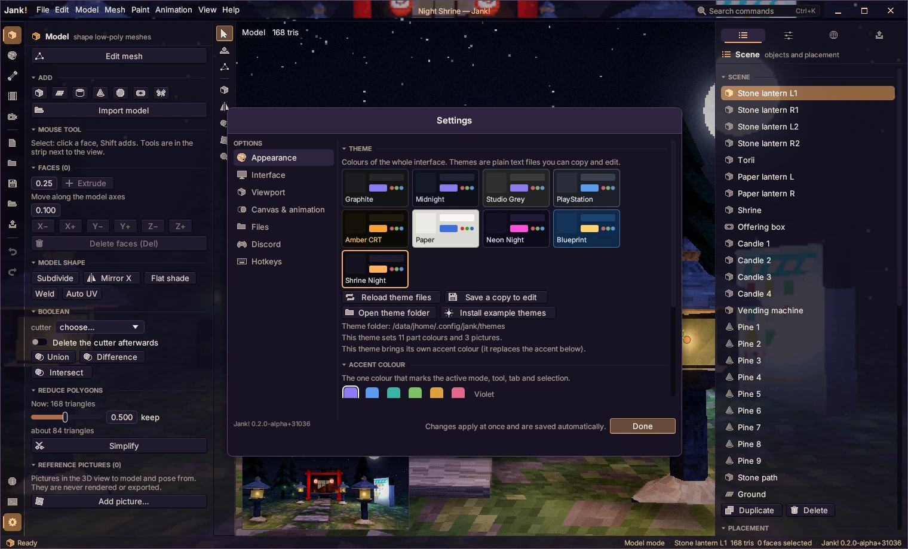
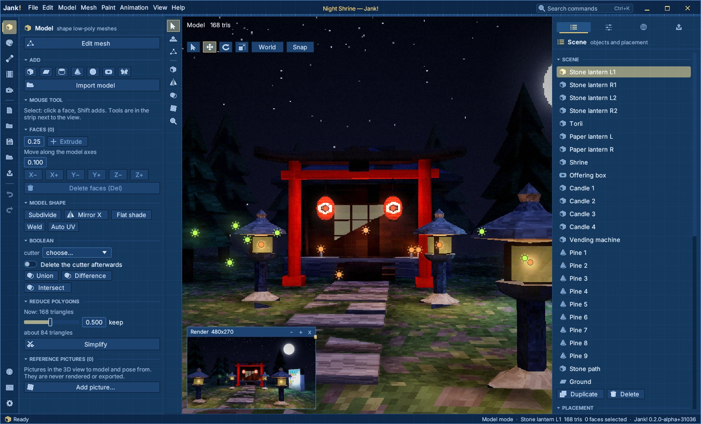

# Themes

A theme sets the look of the whole window: colours, the colour of single parts (title bar, menus, buttons, timeline…), sizes such as corner radii and shadows, and pictures for the background, the title bar, the panels and more. Themes are plain text files, so you can write, share and keep them with your projects.



## Choosing and making a theme

*Settings → Appearance → Theme* shows every theme as a card; click one to switch. Seven themes are built in: Graphite (the default), Midnight, Studio Grey, PlayStation, Amber CRT, Paper (light) and Neon Night.

- **Install example themes** writes two themes with pictures into the theme folder: *Shrine Night* (a render of `demo/night-shrine.jank` behind see-through panels and in the title bar) and *Blueprint* (a tiled grid). They are good starting points.
- **Save a copy to edit** writes the current theme as a file in which every key is listed and explained. Change the name and edit it in any text editor.
- **Open theme folder** shows the folder in the file manager; **Reload theme files** reads it again.
- While Jank! runs, the active theme is watched: save the file (or one of its pictures) and the window changes within a second.
- Problems (an unknown key, a colour that is not `#rrggbb`, a missing picture) are listed under the theme cards; the rest of the file still works.

The theme folder is `themes/` in the settings folder, usually `~/.config/jank/themes/` (or `$JANK_CONFIG_DIR/themes/`). Every `*.theme` file there is a theme (up to 64); a theme with the same name as a built-in one replaces it. Pictures are looked up next to the theme file and in an `images/` folder beside it; absolute paths work too.

## The file

One `key = value` per line. `#` starts a comment, also after a value. Keys that are missing are taken from Graphite, so a theme can be three lines long:

```text
name = Night Shift
accent = #ff8a3d
bg1 = #1b1625
```

Colours are `#rrggbb`. Besides the keys below there are:

| Key | Meaning |
|---|---|
| `name` | Name on the card (up to 40 characters). Settings remember the theme by this name. |
| `light` | `true` for light themes: dark text on bright surfaces, lighter shadows. Guessed from `bg1` when missing. |
| `accent` | Replaces the accent colour chosen in Settings (optional). |

## Base colours

| Key | Used for |
|---|---|
| `bg0` | deepest surface: menu bar, ribbon, around the viewport |
| `bg1` | panels |
| `bg2` | controls (buttons, fields) |
| `bg3` | hovered controls |
| `line` | borders |
| `line_soft` | soft separators |
| `text` | text |
| `dim` | dim text and captions |
| `hilite` | top/left pixel bevel of buttons |
| `shade` | bottom/right pixel bevel of buttons |
| `warn` | warnings |
| `danger` | destructive actions (delete) |
| `viewport` | background around the 3D picture |
| `axis_x` | X axis (red) |
| `axis_y` | Y axis (green) |
| `axis_z` | Z axis (blue) |

## Colours of single parts

Each of these falls back to the colour in the *Default* column when it is not set (`accent` is the accent colour), so a theme only names the parts it wants to change.

| Key | Colours | Default |
|---|---|---|
| `titlebar` | title bar and menu bar | `bg0` |
| `titlebar_text` | document title in the title bar | `dim` |
| `ribbon` | icon column at the far left | `bg0` |
| `toolstrip` | tool column next to the viewport | `bg1` |
| `panel` | side panels | `bg1` |
| `statusbar` | status bar | `bg0` |
| `statusbar_text` | status bar text | `dim` |
| `window` | dialogs, menus and pop-ups | `bg1` |
| `window_border` | border of dialogs, menus and pop-ups | `line` |
| `tooltip` | tooltip background | `bg2` |
| `tooltip_text` | tooltip text | `text` |
| `button` | buttons | `bg2` |
| `button_hover` | hovered buttons | `bg3` |
| `button_text` | text on buttons | `text` |
| `input` | text fields | `bg0` |
| `selection` | selected text and list items | `accent` |
| `timeline` | timeline background | `bg1` |
| `timeline_frame` | frame cells in the timeline | `bg2` |
| `playhead` | current frame marker in the timeline | `accent` |
| `link` | links | `accent` |

## Sizes

Values outside the range are clamped.

| Key | What it does | Default | Range |
|---|---|---|---|
| `radius` | corner radius of buttons and fields, in points | 3 | 0 to 16 |
| `window_radius` | corner radius of dialogs | 6 | 0 to 24 |
| `menu_radius` | corner radius of menus and pop-ups | 4 | 0 to 16 |
| `border` | width of control borders (0 = none) | 1 | 0 to 3 |
| `shadow` | strength of dialog and menu shadows (0 = none) | 1 | 0 to 2 |
| `shadow_blur` | softness of the shadows | 18 | 0 to 48 |
| `spacing` | space between controls (1 = normal) | 1 | 0.6 to 1.8 |
| `panel_opacity` | below 1 the background picture shows through the panels | 1 | 0 to 1 |
| `titlebar_height` | height of Jank's own title bar | 30 | 24 to 48 |
| `scrollbar_width` | width of scroll bars | 8 | 4 to 16 |
| `bevel` | pixel bevel on buttons (0 = flat buttons) | 1 | 0 to 1 |

## Pictures

A picture can be shown in nine places. PNG, JPEG, BMP, TGA and PPM are read, up to 8192 pixels on a side.

| Place | Where |
|---|---|
| `background` | behind the whole window; shows through panels when panel_opacity is below 1 |
| `titlebar` | the title bar |
| `ribbon` | the icon column at the far left |
| `panel` | the side panels |
| `statusbar` | the status bar |
| `viewport` | around the 3D picture (visible in Render mode and when the view is empty) |
| `welcome` | the welcome screen |
| `timeline` | behind the timeline |
| `logo` | replaces the Jank! wordmark in the title bar |

For each place:

| Key | Meaning |
|---|---|
| `<place>_image = file` | The picture (`background = file` works too). `none` or an empty value removes it. |
| `<place>_mode` | How it fills its place: `cover` (fills it, cropping what sticks out; the default), `tile` (repeats at its own size), `stretch` (fills it exactly, distorting), `center` (its own size in the middle), `fit` (as large as fits entirely). `<place>_fit` is the same key. |
| `<place>_opacity` | 0 to 1 (default 1). |
| `<place>_tint` | `#rrggbb` that multiplies the picture's colours. |

The keys can also be written `<place>_image_mode`, `<place>_image_opacity` and `<place>_image_tint`. For the panel picture that form is needed: `panel_opacity` is the size that makes the panels see-through, the panel picture's own opacity is `panel_image_opacity`.

A background picture is only visible where the window lets it through: set `panel_opacity` below 1 (0.8 to 0.9 keeps text easy to read).



## Example

The Shrine Night example (written by *Install example themes*, also in `core/assets/themes/`):

```text
name = Shrine Night
light = false
accent = #ffb25c

bg0 = #0c0a12
bg1 = #14111d
text = #f2e8dc
titlebar = #120e1b
titlebar_text = #ffcf96
playhead = #ff8f4a

radius = 4
window_radius = 9
bevel = 0.5
panel_opacity = 0.82

background = shrine-night.png
background_mode = cover
titlebar_image = shrine-night.png
titlebar_opacity = 0.35
```

The reference implementation is `core/src/themes.rs` (reading and writing) and `app/src/theme.rs`, `app/src/themeart.rs` (applying it).
