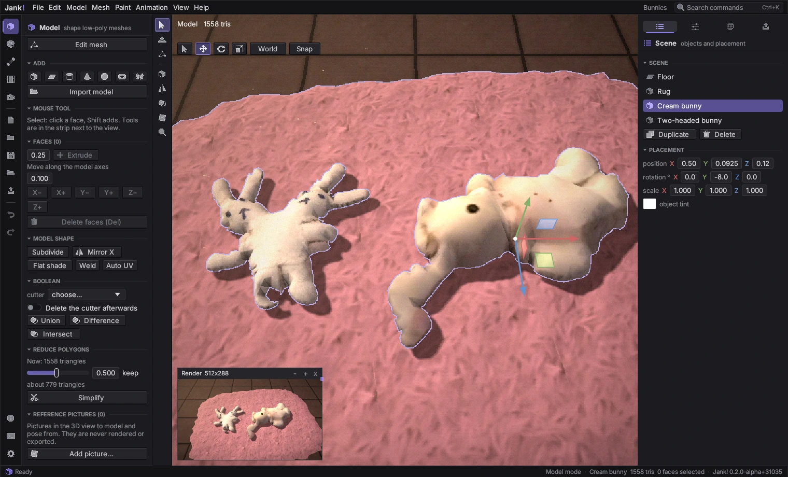
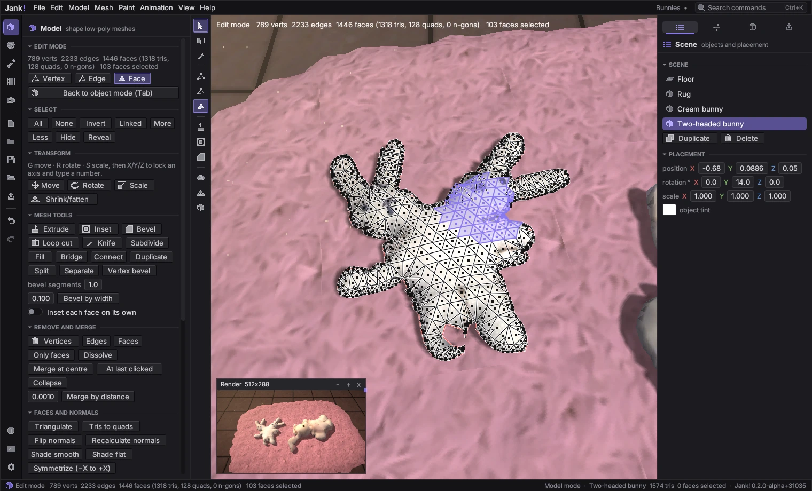
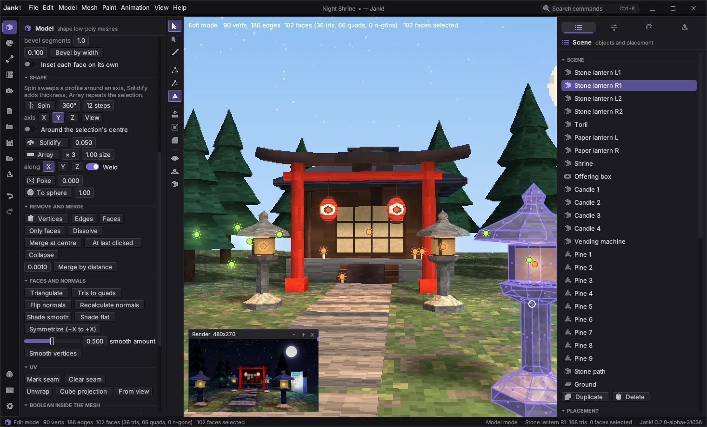
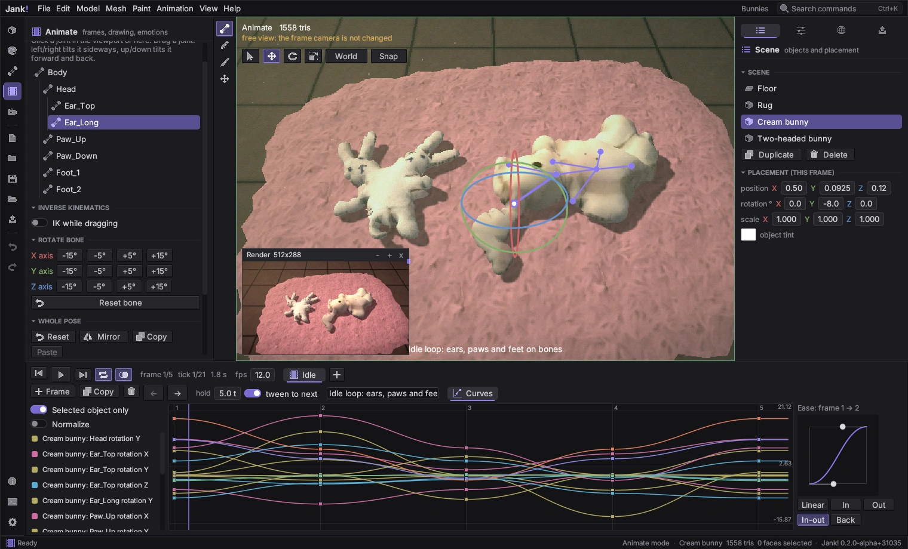
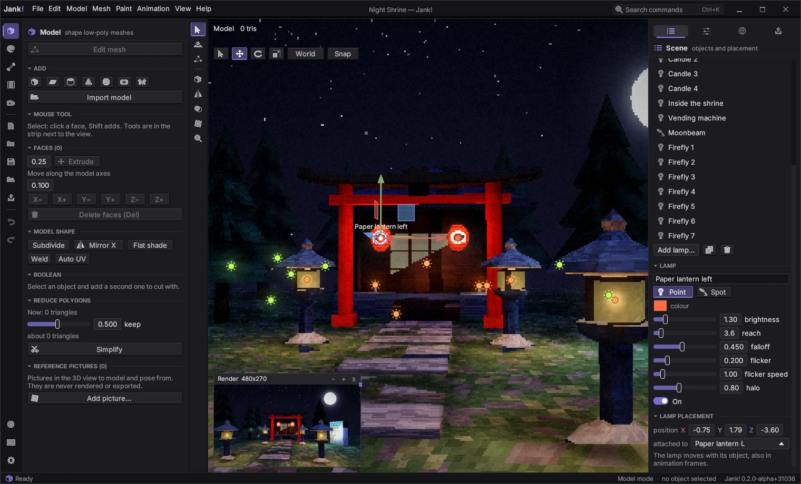
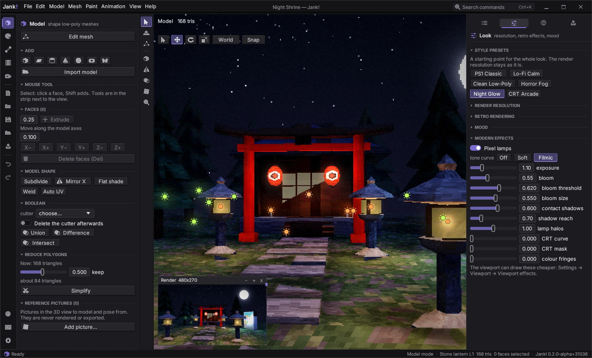
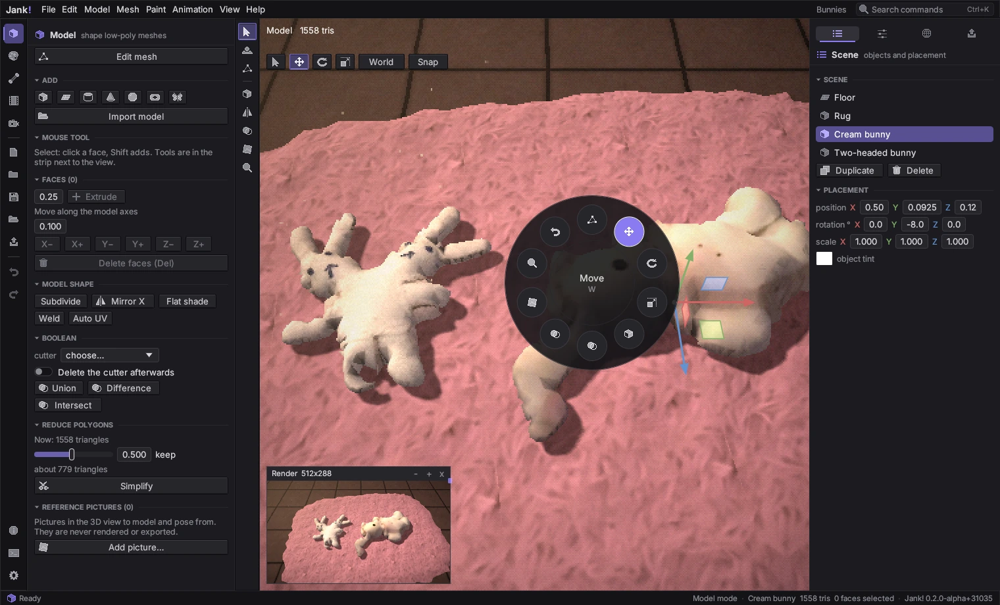
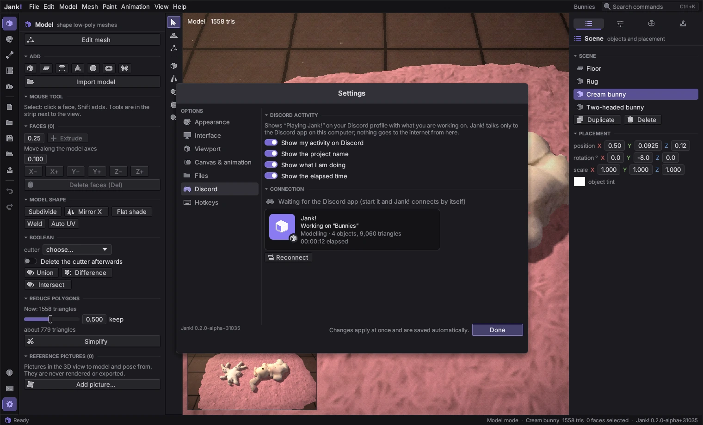
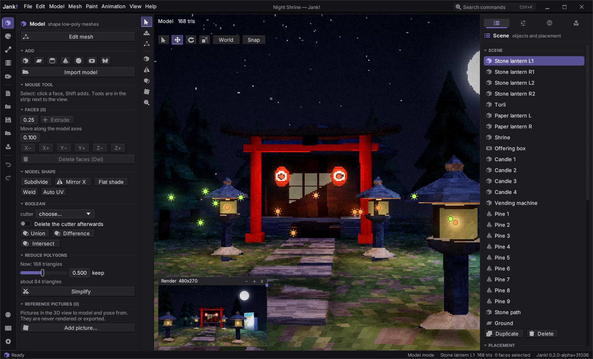

# Jank! user guide

A short tour of the program. Hold the mouse over any control to see its tooltip, and press `Ctrl+K` to search every command by name.

## The window

- **Title bar and menu bar** in one strip: File, Edit, Model, Mesh, Paint, Animation, View, Help, the project name, *Search commands* and the window buttons. Drag the strip to move the window, double-click it to maximise; the window can be resized from every edge. *Settings → Interface → Window* brings back the title bar of your system (after a restart). *Help → What's new* lists the changes of this version.
- **Mode tabs** (keys `1`-`5`): Model, Texture, Pose, Animate, Render.
- **Viewport** in the middle: the 3D scene. Drag with the middle or right mouse button (or Alt + left) to orbit, hold Shift to pan, scroll to zoom. `Home` frames everything.
- **Right panel** with tabs: Scene, Look, World, Output.
- **Timeline** for animation, **status bar** with version and hints.
- `F3` shows performance statistics. `Shift+P` opens a window with the real final picture.

## Projects

| Action | Key |
|---|---|
| New / Open / Save / Save as | `Ctrl+N` / `Ctrl+O` / `Ctrl+S` / `Ctrl+Shift+S` |
| Import a model (OBJ, STL, PLY, glTF, GLB) | `Ctrl+I` |
| Export a photo or video | `Ctrl+E` |

A project is one `.jank` file holding models, textures, skeletons, animations, scene layers and lighting. Jank! autosaves while you work; if it closes unexpectedly, it offers to recover your work at the next start.

## 1. Model

- `Shift+A` adds a cube. Other primitives are in the `Model` menu and the Add row: plane, cylinder, cone, sphere, torus, butterfly.
- Gizmos: `Q` select, `W` move, `E` rotate, `R` scale. `Shift+L` switches world/local axes, `Shift+S` turns snapping on or off.
- Tools: subdivide, mirror along X, weld vertices, flat shading, automatic UV unwrap (`U`), polygon reduction.
- `Delete` removes the selection.
- The object under the mouse is outlined, so you see what a click selects (Settings → Viewport → Highlight).
- **Boolean** section: choose a cutter object and press Union, Difference or Intersect. Both meshes should be closed. *Delete the cutter afterwards* removes it.
- **Reference pictures**: *Add picture...* places a drawing in the 3D view (front, side, top or facing the view). Drag it with the Select tool, change size and opacity in the panel. They are never rendered or exported.

### Edit mode

Press `Tab` (or *Edit mesh*) to edit the selected object's vertices, edges and polygons; `Tab` again goes back. Keys work as in Blender:

| Action | Key |
|---|---|
| Vertex / edge / face select | `1` / `2` / `3` |
| Select, add, box select | click, Shift+click, drag (Shift adds, Ctrl removes) |
| Edge loop / ring / shortest path | Alt+click / Ctrl+Alt+click / Ctrl+click |
| All, none, invert, linked, more, less | `A`, `Alt+A`, `Ctrl+I`, `L` (under the mouse) or `Ctrl+L`, `Ctrl+=`, `Ctrl+-` |
| Hide / hide others / reveal | `H` / `Shift+H` / `Alt+H` |
| Move, rotate, scale | `G`, `R`, `S`, then `X`/`Y`/`Z` (Shift+axis: the other two), type a number, `Enter` or click to confirm, `Esc` or right click to cancel; Ctrl snaps, Shift is fine |
| Extrude, inset, bevel | `E`, `I`, `Ctrl+B` (wheel: segments) |
| Loop cut and slide | `Ctrl+R`, point at an edge, wheel for more cuts, click, then slide |
| Knife | `K`, click points, `Enter` cuts, `Esc` stops |
| Fill, connect, split, separate | `F`, `J`, `Y`, `P` |
| Duplicate, delete, dissolve, merge | `Shift+D`, `X`, `Ctrl+X`, `M` |
| Proportional editing, X-ray | `O` (wheel changes the radius while moving), `Alt+Z` |
| UV unwrap from seams | `U` |
| Extrude each face on its own, to sphere | `Alt+E`, `Alt+Shift+S` |

The left panel has every tool as a button, plus subdivide, bridge, triangulate, tris to quads, normals, smooth and flat shading, symmetrize, seams, mirror editing and Boolean inside the mesh (selected faces against the rest). Quads and n-gons are kept when you save. The *Mesh* menu holds the same tools, with *Normals and shading*, *UV* and *Select and show* in submenus.

**Shape tools** (the *Shape* section of the left panel):

- **Spin**: sweeps the selected edges or faces around an axis (X, Y, Z or the view direction), like a lathe. Set the angle (360° closes the ring) and the number of steps; by default it turns around the object's centre, *Around the selection's centre* uses the selection instead. Draw half the outline of a vase, a lantern or a column with edges, then spin it.
- **Solidify**: gives the selected faces an even thickness, with a rim along their border (a negative value grows outwards).
- **Array**: repeats the selection along X, Y or Z; the step is measured in sizes of the selection (1 = touching), *Weld* merges the vertices where copies touch.
- **Poke**: splits each selected face into a fan around its centre; a depth above 0 raises the middle into a point.
- **To sphere**: rounds the selection towards a sphere (1 = fully).
- **Extrude each face** (`Alt+E`) and **Extrude along normals** push every face out on its own or along its own direction instead of as one block.

## 2. Texture

- Paint straight on the texture or on the model. Tools: brush, eraser, fill, picker, line, rectangle, selection (rectangle, wand, UV island).
- More tools: smudge, blur, dodge and burn, gradient (`G`, from the main to the second colour, dithered in pixel mode). `X` swaps the main and the second colour, `[` and `]` change the size. *Symmetric painting* mirrors the stroke, the *stabilizer* smooths shaky lines.
- *Projection painting in 3D* paints through the view onto everything that is visible, across UV seams and objects.
- **Indexed colour**: *Convert to indexed* locks the texture to the current palette. Every pixel then stores a palette entry; right-click an entry to change its colour and the whole texture follows (like PlayStation CLUTs). *Back to full colour* undoes the lock.
- Palettes hold your colours; save them as `.jankpal` files. Colour reduction and dithering give the PSX look.
- **Layers**: paint on separate layers and blend them. Scene layers put a picture behind or in front of the 3D scene.

## 3. Pose

Imported glTF/GLB models with a skeleton can be posed (the bunnies of `demo/bunnies.jank` have one): select a bone and rotate it with the gizmo. Turn on **inverse kinematics** (`Shift+I` or the IK cell) and drag the end of a limb: the bones above it follow; *chain bones* sets how many (1-8).

## 4. Animate

- Animation is frame by frame: `Shift+N` adds a frame, `Shift+D` duplicates one, `,` and `.` step back and forward, `Shift+Space` plays.
- The **Curves** tab of the timeline is the graph editor: every animated value as a curve. Drag a key up or down to change it, click the graph to go to a frame. On the right, choose the easing of the current in-between (linear, in, out, in-out, back) or drag the two Bézier handles.
- Onion skin shows neighbouring frames. Each frame can have its own camera and a hand-drawn overlay.

## 5. Render

- Presets set the PSX look: vertex snapping, affine textures, colour bits, dithering, fog, resolution.
- **World** tab: turn on *Time of day* and move the hour (sun 06:00-18:00, moon 18:00-06:00). Choose a shadow mode: *Off*, *Blob* (soft spots under objects) or *Cast* (real shadows; set strength, softness and quality).
- **Output** tab / `Ctrl+E`: save a photo (PNG, JPEG, BMP, TGA, PPM) or a video (GIF, AVI).

## Lamps

Lamps light the scene around them: candles, lanterns, neon signs, campfires, fireflies, spotlights. They are in the **Scene** tab on the right, under *Lamps*: *Add lamp…* offers presets (Bulb, Candle, Lantern, Campfire, Torch, Neon, Moonbeam, Spotlight, Firefly). A new lamp appears at the selected object (or where the view looks); drag its handles in the viewport or type its position.

- **Point** lamps shine in every direction, **Spot** lamps in a cone (set the cone, the soft edge and the aim).
- *brightness*, *reach* (metres until the light is gone) and *falloff* shape the pool of light; *flicker* makes it waver like a flame during playback (the same every time); *halo* draws a glow around the lamp itself.
- *attached to*: hang the lamp on an object, for example a candle flame on its candle; it then moves with the object in every animation frame.
- The eye in the list switches a lamp on and off; right-click for *Duplicate* and *Delete*. Lamps are drawn as small suns in the lamp's colour; click one to select it.

## Look: style presets and modern effects

The **Look** tab sets the whole picture. **Style presets** set everything in one click: *PS1 Classic*, *Lo-Fi Calm*, *Clean Low-Poly*, *Horror Fog*, *Night Glow* (made for lamps at night) and *CRT Arcade*. The render resolution stays as it is.

Below the retro settings and the mood, **Modern effects** add touches the PlayStation never had:

- **Pixel lamps**: light is worked out for every pixel, so lamps make round, smooth pools even on big faces. Off: per vertex, the PS1 way.
- **Tone curve** (*Off*, *Soft*, *Filmic*) and **exposure**: very bright light rolls off instead of burning to white.
- **Bloom** (with threshold and size): bright parts glow.
- **Contact shadows** (ambient occlusion) with their reach: soft darkening in corners, creases and where objects touch.
- **Lamp halos**: the glow of each lamp's *halo*.
- **CRT curve**, **CRT mask** and **colour fringes**: the glass, the RGB stripes and the colour fringing of an old screen.

On a slow computer, *Settings → Viewport → Viewport effects* draws them cheaper in the editing view (*Light* keeps lamps per vertex and drops contact shadows and bloom; *Off* shows the plain retro picture). Renders, exports and the preview window always use the full style.

## Radial menu

Hold `Space` over the view, point at a tool and release (or tap `Space` and click), as in Krita. The ring shows the tools of the current mode - mesh tools in Edit mode, brushes and recent colours while painting.

## Settings and shortcuts

`Ctrl+Comma` (or the gear at the bottom of the ribbon) opens Settings:

- **Appearance**: theme (seven built in, one light; *Install example themes* adds Shrine Night and Blueprint, which bring pictures; *Save a copy to edit* writes a `.theme` text file with every key explained, and Jank! picks up your edits while it runs - see [THEMES.md](THEMES.md)), accent colour, Compact or Comfortable spacing, text size, the tool strip, the status bar and the frame rate in it.
- **Interface**: interface scale, tooltips, reduced motion, panel layout, *Use the system title bar* (after a restart).
- **Viewport**: sharpness, *Viewport shadows* (like the render, up to Medium, Blob or Off) and *Viewport effects* (like the render, Light or Off) - only the editing view, never the render or export -, redraw only when something changes, orbit and zoom speed, inverted vertical orbit, render threads, the preview window.
- **Canvas & animation**: pixel grid of the texture editor, onion-skin strength, composition guides for Render mode (thirds, centre, safe area, golden ratio).
- **Discord**: show *Playing Jank!* on your Discord profile; choose whether the project name, the details and the time are shown. The card below the switches shows exactly what your friends will see (see [DISCORD.md](DISCORD.md)).

  
- **Files** and **Hotkeys**: autosave and recovery; every shortcut can be changed, `F1` shows the current list.

## The workspace

The ribbon on the far left switches the five modes and holds New, Open, Save, Import, Export, Undo and Redo. Next to the viewport sits the tool strip with the tools of the current mode: Select and Sculpt when modelling; Pencil, Brush, Eraser, Bucket, Eyedropper, Line, Rectangle, Filled rectangle and the selection tools when painting; Pose, Draw, Paint and Move when animating; guides, preview window and camera view when rendering. Click a section title in a panel to fold it. `Ctrl+K` or the *Search commands* field at the top runs any command by name.

## Where Jank! keeps its files

Settings and key bindings go to your XDG config folder, autosave to the XDG state folder. You can move them with `JANK_CONFIG_DIR` and `JANK_STATE_DIR` (see [BUILDING.md](../BUILDING.md)).

## Trying the demo

Open `demo/bunnies.jank` with `File > Open project`: two plush bunnies on a pink rug in warm evening light. Both were made from photos: the outline gives the shape, the photo becomes the texture (front and back), and each has a skeleton - the cream bunny moves its ears, paws and feet in a short *Idle* loop.

Things to try: press `Shift+Space` to play, `3` to see the bones, `2` for the texture, `5` for the render, select a bunny and press `Tab` for its polygons, or open the World tab to change the light and the shadows.

`demo/night-shrine.jank` shows the lamps and the modern effects: a small shrine at night with stone and paper lanterns, candles, a glowing vending machine, a moonbeam and fireflies, about 25 lamps in the *Night Glow* style. Open the Look tab to switch presets, or select a lamp in the Scene tab and change its colour. It was built with the new mesh tools: the stone and paper lanterns with *Spin*, the curved top beam of the torii with *Solidify*, the stone path and the shrine steps with *Array*, the shrine roof with *Poke*.

More samples are in `demo/`: `butterfly.jank` (a rigged butterfly over a meadow, with time of day) and `friend.jank` (a singing worm).

## Privacy

Jank! works fully offline: no account, no telemetry, no update check. If you turn on the Discord status (`Settings > Discord`), the mode and what you are doing are passed to the Discord app on your computer; the project name only if you allow it. Details: [DISCORD.md](DISCORD.md).

## Help and contact

`F1` opens *About*: version, build and platform for a bug report (*Copy to clipboard*), the shortcuts, the licences and the author's contact. Bugs and ideas go to [GitHub Issues](https://github.com/wwwthresis/Jank/issues); questions, licences and security reports to the author, Thresis, at [thresiss@gmail.com](mailto:thresiss@gmail.com).
